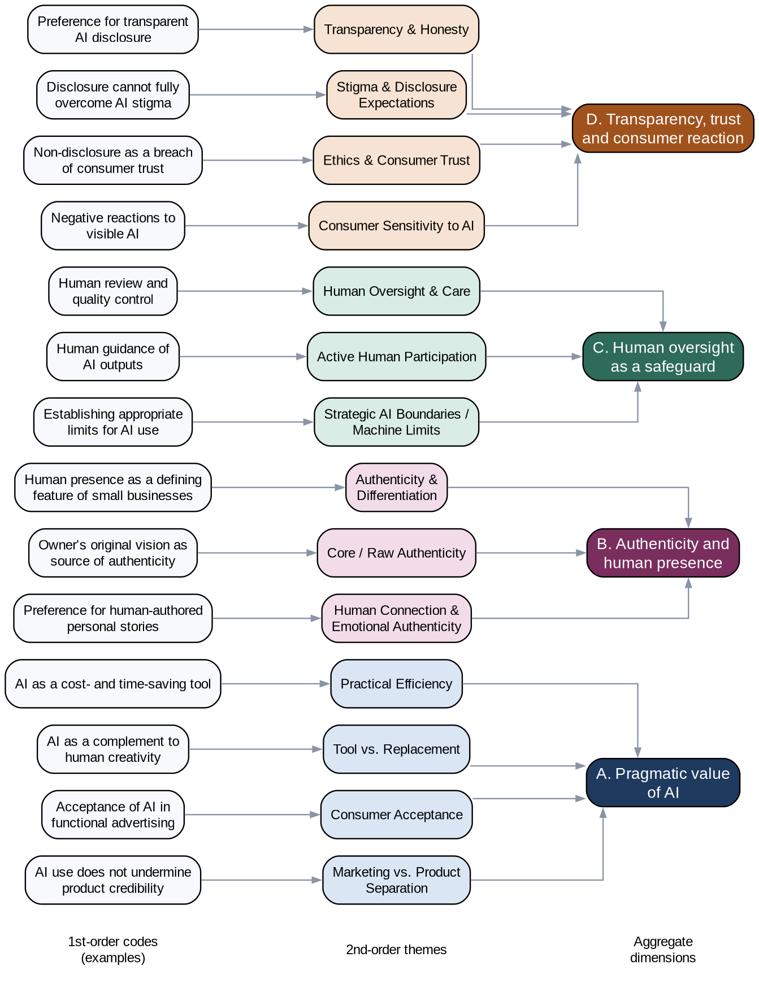

# Section 3. Data structure and conceptual framework

*Group draft for Activity 2, written for the role "Data structure" (Yelyzaveta). The consolidated coding table in the group document is the source of the codes and themes. AI-use declaration: an AI assistant was used to organise the consolidated codes into dimensions and to draft this text; the dimensions and wording must be checked against the final merged codebook (Meeting 2) before submission.*

## 3.1 Data structure

Following a Gioia-style presentation, the analysis moves from first-order codes (close to the interviewees' words) to second-order themes and then to aggregate dimensions. Figure 1 shows the structure. For readability it displays one representative first-order code per theme; the full list is in the Appendix table.

The merged codes group into 14 second-order themes, which form four aggregate dimensions:

- **A. Pragmatic value of AI.** *Practical Efficiency, Tool vs. Replacement, Consumer Acceptance, Marketing vs. Product Separation.* Both marketers and consumers accept AI when it saves time or money and handles routine work, and consumers separate the way a product is advertised from its real quality.
- **B. Authenticity and human presence.** *Authenticity & Differentiation, Core / Raw Authenticity, Human Connection & Emotional Authenticity.* A small business is expected to show a human face and the owner's own vision, especially in personal stories and visuals.
- **C. Human oversight as a safeguard.** *Human Oversight & Care, Active Human Participation, Strategic AI Boundaries / Machine Limits.* Acceptance depends on a person guiding, reviewing and limiting the AI output.
- **D. Transparency, trust and consumer reaction.** *Transparency & Honesty, Stigma & Disclosure Expectations, Ethics & Consumer Trust, Consumer Sensitivity to AI.* Honest disclosure is preferred, hidden use is seen as a breach of trust, and disclosure reduces but does not remove negative reactions.

## 3.2 Conceptual framework

The themes are related as follows (Figure 2 is the same logic in words):

1. **AI use has pragmatic value (A)** for small businesses, which explains why marketers use it and why consumers tolerate it in functional contexts.
2. **That value is limited by authenticity expectations (B).** The more personal or emotional the content (stories, product photos, one-to-one communication), the less acceptable AI becomes. The *type and stakes of the content* therefore act as the main boundary condition.
3. **Human oversight (C) mediates between A and B.** When a person guides, edits and takes responsibility for the output, AI becomes a tool rather than a replacement, and the perceived loss of authenticity is smaller.
4. **Disclosure (D) shapes how the result is judged.** Honest disclosure supports trust and shows respect, whereas non-disclosure is read as deception. Disclosure does not fully remove stigma, so its effect is to reduce negative reactions, not to create acceptance.

In short: *the effect of AI on perceived authenticity and trust depends on what the AI is used for (A and B), on how much human control is visible (C), and on whether its use is disclosed (D).* This answers the research question about how disclosure affects authenticity and trust: disclosure protects trust, but authenticity is mainly protected by human involvement and by keeping AI away from personal content.

**Contrast worth quoting in Section 4:** Interviewee 2 rejects visible AI, while Interviewee 6 accepts it when the owner reviews the output, which fits the role of oversight (C).

## Notes for the group

- Replace the example codes in Figure 1 if the merged codebook changes after Meeting 2; the editable source is `data_structure_figure.dot` (open it with Graphviz, or ask for a PowerPoint version).
- The dimension names are a proposal. If the group prefers different labels, change them in both the text and the figure.
- Numbers of codes and verbatims per code come from Amelie's Appendix table; this section does not state them.
