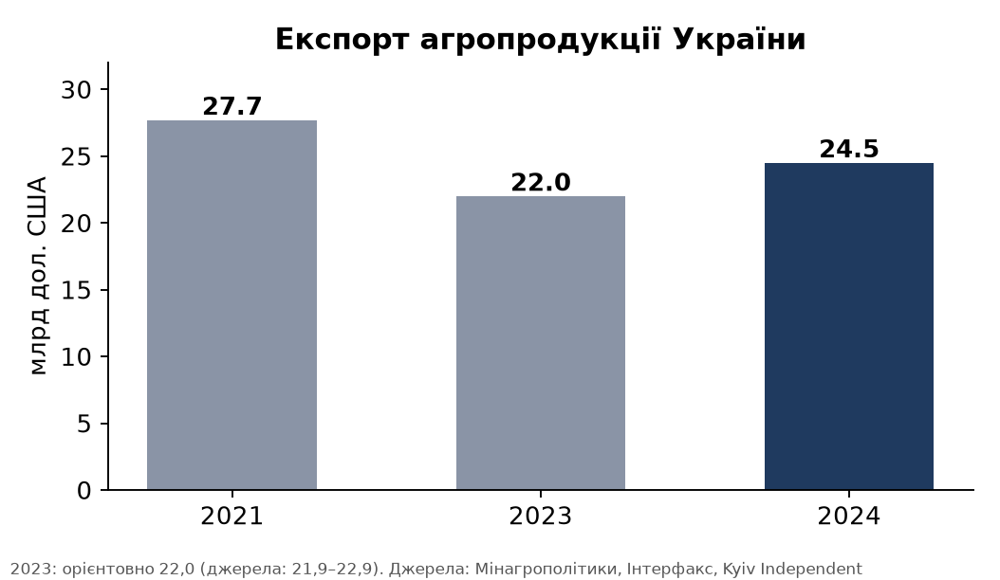
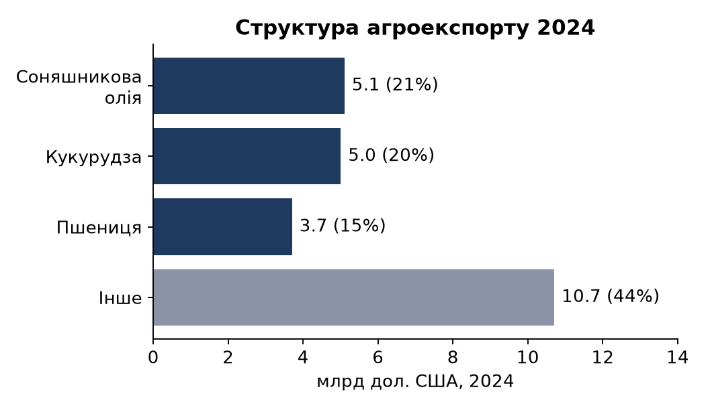
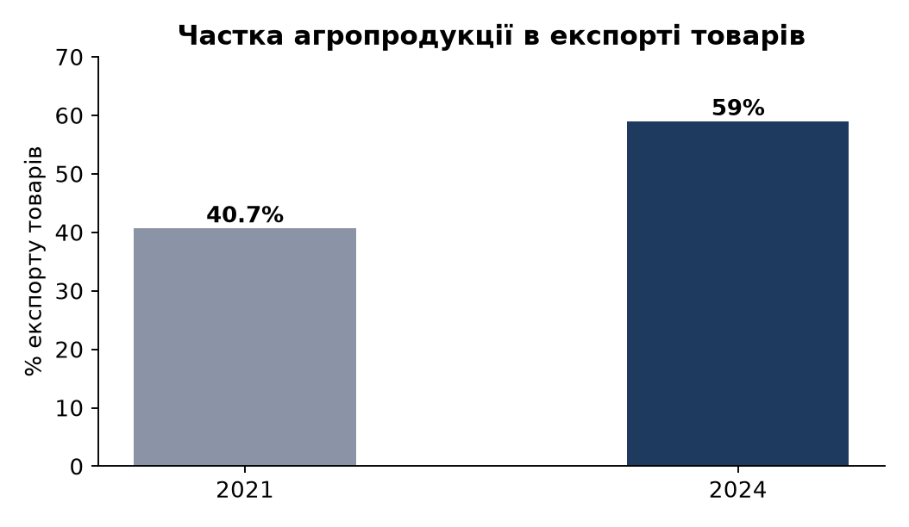

# Розрахунково-графічна робота: «Міжнародна економіка в одному кейсі»

**Кейс:** Агроекспорт України: відновлення обсягів після війни та зміна ринків збуту (2021–2024)

**Виконала:** Євтухова Єлизавета, студентка 3 курсу, групи [група]. **Викладач:** к.е.н., доц. Шуба М.В.

*Чернетка підготовлена за допомогою ШІ-асистента (пошук статистики, розрахунки, графіки, структура тексту). Студентка має самостійно перевірити дані за першоджерелами, переписати текст своїми словами та вказати використання ШІ у роботі, якщо цього вимагає викладач.*

## 1. Назва та постановка проблеми

Україна належить до провідних світових експортерів зернових, олійних культур і соняшникової олії. Повномасштабне вторгнення 2022 року порушило виробництво й логістику (блокада чорноморських портів, пошкодження інфраструктури, мінування полів), однак у 2024 році агроекспорт повернувся до довоєнного рівня за обсягом (78,3 млн тонн), хоча не за вартістю. Проблема дослідження: як змінилися обсяги, структура й географія агроекспорту України після 2021 року та що це означає для економіки країни та світових ринків продовольства. Актуальність: агроекспорт дає понад половину експорту товарів, тому визначає надходження валюти й продовольчу безпеку інших країн.

## 2. Теоретичне пояснення

- **Експорт** це вивезення товарів і послуг за кордон для продажу; його вартість залежить від обсягу та світових цін.
- **Товарна структура експорту** розподіл вартості експорту за групами товарів; висока концентрація (кілька товарів) підвищує вразливість до цінових і торговельних шоків.
- **Географічна диверсифікація** розподіл експорту між ринками; залежність від одного ринку збільшує ризик торговельних обмежень.
- **Відносні показники:** темп приросту (T = (Y₁ / Y₀ − 1) × 100%) і частка (Ч = Y_частини / Y_цілого × 100%) для порівняння показників у часі та за структурою.
- **Умови торгівлі та ціновий ефект:** обсяг експорту у фізичних одиницях може зростати, а виручка зменшуватись, якщо падають світові ціни.

## 3. Аналіз кейсу

**Учасники.** Експортери (агрохолдинги, переробники, фермери); держава (Мінагрополітики, Мінекономіки, митна служба); імпортери (ЄС, країни Африки й Азії); міжнародні організації, що фінансують і страхують проєкти.

**Потоки й механізми.** Основні експортні групи 2024 року: соняшникова олія (близько 21% вартості, майже 6 млн тонн на 5,1 млрд дол.), кукурудза (близько 5 млрд дол., 29,6 млн тонн) і пшениця (3,7 млрд дол., 20,6 млн тонн) ([Мінагрополітики за матеріалами Kyiv Independent та dengi.ua](https://dengi.ua/en/agro/9751555-agricultural-products-made-up-59-procent-of-ukraines-exports-what-was-exported)). Основний ринок ЄС: у 2024 році вартість українського агропродовольчого експорту до ЄС становила 13 млрд євро (+11%), і Україна стала третім постачальником агропродукції до ЄС із часткою близько 8% загального імпорту (за даними Єврокомісії, наведеними в [Українській правді](https://epravda.com.ua/biznes/u-triyci-golovnih-ale-ne-persha-komu-ukrajina-postupayetsya-za-agroeksportom-do-yes-806701/)).

**Причинно-наслідкові зв'язки.** (1) Війна й блокада портів зменшили експорт і виручку у 2022–2023 роках. (2) Відновлення морського коридору й нарощування наземної логістики повернули обсяги в 2024 році. (3) Нижчі світові ціни на агросировину та витрати на логістику стримали виручку: обсяг експорту у 2023 році зростав, а виручка падала (9,5 млн тонн додатково, але менше доходу, за матеріалами [Ukragroconsult](https://ukragroconsult.com/en/news/ukraines-agricultural-exports-decreased-by-1-5-billion-in-2023/)). (4) Торговельні обмеження сусідів з ЄС і зміни режиму торгівлі спонукали шукати інші ринки.

## 4. Розрахункова частина

Вихідні дані (млрд дол. США): 2021, 27,7 ([Kyiv Independent](https://kyivindependent.com/ukraine-hits-24-5-billion-in-agro-exports-nearing-pre-war-levels-agriculture-ministry-reported)); 2023, близько 22,0 (джерела дають 21,9–22,9, тому беремо 22,0 за заявою міністра, див. [Kyiv Independent](https://kyivindependent.com/ukraine-exported-products-worth-22-billion-in-2023/)); 2024, 24,5 ([Кабмін](https://www.kmu.gov.ua/en/news/u-2024-rotsi-ahrarna-produktsiia-sklala-59-v-zahalnomu-eksporti)). Дані за 2022 рік у джерелах розходяться (від близько 21,4 до 23,4 млрд дол.), тому вони не використовувалися.

| Показник | Формула | Розрахунок | Результат |
|---|---|---|---|
| Приріст 2024 до 2023 | (24,5 / 22,0 − 1) × 100% | 1,1136 − 1 | **+11,4%** |
| Приріст 2024 до 2021 | (24,5 / 27,7 − 1) × 100% | 0,8845 − 1 | **−11,6%** |
| Частка агропродукції в експорті товарів 2024 | 24,5 / 41,6 × 100% | 0,589 | **58,9%** (≈59%) |
| Частка соняшникової олії в агроекспорті 2024 | 5,1 / 24,5 × 100% | 0,208 | **20,8%** |
| Частка кукурудзи | 5,0 / 24,5 × 100% | 0,204 | **20,4%** |
| Частка пшениці | 3,7 / 24,5 × 100% | 0,151 | **15,1%** |

(Загальний експорт товарів 2024 року 41,6 млрд дол. за [Інтерфакс-Україна](https://interfax.com.ua/news/blog/1045874.html); міністерство дає близько 41 млрд, тому частка коливається в межах 59–60%.)

**Інтерпретація.** Вартість агроекспорту 2024 року на 11,4% вища за 2023-й, що показує відновлення після найгіршого року війни, але все ще на 11,6% нижча за рекордний 2021-й, хоча фізичні обсяги вже відповідають довоєнним (78,3 млн тонн). Різниця означає, що виручку обмежують світові ціни та вищі логістичні витрати. Три продукти (олія, кукурудза, пшениця) дають приблизно 56% вартості, тож структура сильно концентрована: падіння цін на один із них помітно впливає на валютні надходження. Частка агропродукції у загальному експорті товарів зросла приблизно з 40,7% у 2021 до 59% у 2024 році (дані UCAB і Мінагрополітики), тобто економіка стала залежнішою від сільського господарства, оскільки інші галузі експорту постраждали сильніше.

## 5. Графічна частина

## 6. Економічні наслідки

- **Можливості:** відновлення обсягів дозволяє утримувати валютні надходження; зростання експорту переробленої продукції (олія замість насіння) підвищує додану вартість; наближення до ЄС відкриває ринок і джерела інвестицій.
- **Ризики:** висока залежність від кількох товарів і ринків; торговельні обмеження сусідніх держав і квоти ЄС; воєнні ризики для портів і полів; нестабільність цін.
- **Структурні зміни:** переорієнтація логістики із чорноморських портів на сухопутні маршрути й річкові порти; поступове збільшення частки ЄС (близько 52% агроекспорту у 2024 за даними пошуку; джерело треба звірити, див. [UCAB](https://ucab.ua/files/Position%20paper_EU-UA%20trade.pdf)); скорочення частки африканських ринків.
- **Для світових ринків:** український експорт важливий для продовольчої безпеки країн, що імпортують зерно й олію; його зниження підвищує ціни.

## 7. Висновки

1. У 2024 році агроекспорт України досяг приблизно 24,5 млрд дол., що на 11,4% більше, ніж у 2023, але на 11,6% менше, ніж у рекордному 2021.
2. За фізичними обсягами експорт вийшов на довоєнний рівень (78,3 млн тонн), але виручку стримують ціни та логістика.
3. Структура концентрована: соняшникова олія, кукурудза й пшениця дають близько 56% вартості.
4. Частка агропродукції в експорті товарів зросла до приблизно 59%, тобто залежність економіки від АПК посилилась.
5. Подальший розвиток потребує поглиблення переробки, диверсифікації ринків і зниження логістичних та воєнних ризиків.

## 8. Список використаних джерел

1. Кабінет Міністрів України. У 2024 році аграрна продукція склала 59% у загальному експорті: <https://www.kmu.gov.ua/en/news/u-2024-rotsi-ahrarna-produktsiia-sklala-59-v-zahalnomu-eksporti>
2. Kyiv Independent. Ukraine hits $24.5 billion in agro-exports, nearing pre-war levels: <https://kyivindependent.com/ukraine-hits-24-5-billion-in-agro-exports-nearing-pre-war-levels-agriculture-ministry-reported>
3. dengi.ua. Agricultural Products Made Up 59% of Ukraine's Exports: <https://dengi.ua/en/agro/9751555-agricultural-products-made-up-59-procent-of-ukraines-exports-what-was-exported>
4. Kyiv Independent. Ukraine exported products worth $22 billion in 2023: <https://kyivindependent.com/ukraine-exported-products-worth-22-billion-in-2023/>
5. Ukragroconsult. Ukraine's agricultural exports decreased by $1.5 billion in 2023: <https://ukragroconsult.com/en/news/ukraines-agricultural-exports-decreased-by-1-5-billion-in-2023/>
6. UCAB. Position paper EU–UA trade: <https://ucab.ua/files/Position%20paper_EU-UA%20trade.pdf>
7. Інтерфакс-Україна. Ukrainian agricultural exports: sustainability and strategic growth: <https://interfax.com.ua/news/blog/1045874.html>
8. Українська правда. У трійці головних, але не перша: кому Україна поступається за агроекспортом до ЄС: <https://epravda.com.ua/biznes/u-triyci-golovnih-ale-ne-persha-komu-ukrajina-postupayetsya-za-agroeksportom-do-yes-806701/>

## Що перевірити перед здачею

- Усі цифри звірити з першоджерелами (Мінагрополітики, Мінекономіки, Держмитслужба, UCAB); дані за 2022 і 2023 роки в джерелах розходяться, тому в розрахунках вони позначені.
- Частку 2021 року (40,7%) взято зі збірного джерела UCAB; перевірити, чи вона стосується всього агропродовольчого експорту.
- Додати титульний аркуш за зразком кафедри, номери сторінок і перевірити обсяг (6–8 сторінок без графіків і списку джерел).
